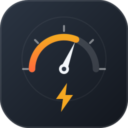

#  ⚡ Modbus 电表 (Modbus Meter)

[](https://github.com/PraxiGEN/ha_modbus_meter/releases)
[](https://github.com/PraxiGEN/ha_modbus_meter/blob/main/LICENSE)

## 将 Modbus TCP 电表接入 Home Assistant。支持通过串口服务器（485 转 WiFi/以太网）将 Modbus RTU 转为 Modbus TCP 的混合接入场景，字典驱动架构让新型号的接入只需一份寄存器档案。

## ✨ 核心特性

### 🏭 字典驱动多型号架构
- **寄存器档案**：每款电表型号对应一份 `MeterProfile` 寄存器字典（块地址、数据点偏移、缩放与精度），协调器与传感器平台均由字典驱动，新增型号零侵入。

**当前支持型号：**

| 型号 | 制造商 | 通讯方式 | 数据点 | 状态 |
| :--- | :--- | :--- | :--- | :--- |
| **DDSU666** | 正泰（Chint） | Modbus TCP 直连 / 485 串口服务器中转（RTU 转 TCP） | 8 | ✅ 完整支持 |

> 新型号接入只需提交一份寄存器档案（`meters.py`），欢迎通过 Issue 或 PR 提供型号手册与实测数据。

### 📊 全量数据点
- **8 个实时传感器**：电压、电流、有功功率、无功功率、视在功率、功率因数、频率、总有功电能。
- **标准设备类**：全部挂载 HA 原生 `device_class` 与单位（V/A/W/var/VA/kWh/Hz），能量实体为 `total_increasing`，可直接接入能源面板。

## 📦 安装

### 通过自定义存储库添加（推荐）

> 自 Home Assistant **2026.11** 起，HACS 已内置为系统自带的 **市场（Marketplace）**，位于 **设置 > 市场**；更早版本请先独立安装 [HACS](https://www.hacs.xyz/)。

**操作步骤：**

1. 打开 Home Assistant，进入 **设置 > 市场**，点击右上角 **⋮ 菜单 > 自定义存储库**
2. 仓库地址填入：
```yaml
https://github.com/PraxiGEN/ha_modbus_meter
```
3. 类别选择 **集成（Integration）**，点击 **添加**
4. 回到市场搜索 **“Modbus 电表”**（或 `Modbus Meter`），进入详情页点击 **安装**
5. 安装完成后会**直接进入配置向导**，选好电表型号并填入连接参数即可使用

> 安装后**无需重启**：集成带配置向导，安装完成即加载并直接引导你完成配置。只有在更新已安装的集成后，系统才会提示重启（按提示操作即可）。

### 手动安装（离线/无市场环境）

1. 下载最新的 Release：
```yaml
https://github.com/PraxiGEN/ha_modbus_meter
```
2. 解压并将 `custom_components/modbus_meter` 文件夹放入 Home Assistant 的 `custom_components` 目录
3. 重启 Home Assistant
4. 前往 **设置 > 设备与服务 > 添加集成**，搜索 **Modbus 电表** 完成配置

## 📖 文档导航
- [🚀 详细配置与使用教程 (DOCS.md)](md/DOCS.md)
- [📜 版本更新历史 (CHANGELOG.md)](md/CHANGELOG.md)

## 🤝 贡献

欢迎贡献代码、报告问题或提出功能建议！

1. 提交Issues：报告问题或功能请求（欢迎提交新电表型号的寄存器档案）
2. 提交Pull Requests：贡献代码改进
3. 项目讨论：分享使用经验或建议

## 📄 许可证

本项目基于MIT许可证开源。详情请查看LICENSE文件。

## ❤️ 支持

如果这个项目对您有帮助，请给项目点个Star ⭐！

## 📜 免责声明

本集成提供的电表数据仅供能耗监测与参考使用，不可作为计费结算或电气安全防护依据。涉及用电安全时，请以专业电气设备与人员为准。

---

## 兼容版本: 

- **Home Assistant 2026.8+**
